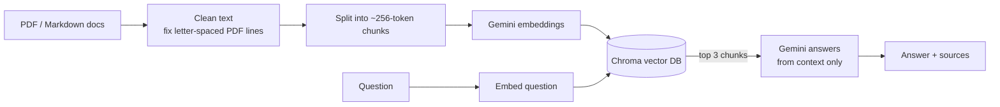

# DLSU Practicum Q&A: a RAG chatbot

Ask questions about the De La Salle University practicum (internship) process and get answers grounded in the official documents, with the exact source passages shown under every answer.

> "Can I start my hours while the IOM is still being processed?"
> **No.** You can apply while it is processed, but deployment without a valid IOM violates CHED policy. *[1] dlsu-practicum-steps.md*

Students usually learn the practicum rules from a one-page infographic, scattered links, and group chats. This project turns those documents into a chatbot that answers in plain language and refuses to guess when the documents don't cover the question.

## How it works



1. **Ingest:** documents in `data/` are loaded, cleaned, split into overlapping chunks, embedded with Gemini, and stored in a local Chroma database.
2. **Retrieve:** the question is embedded and the 3 most similar chunks are pulled from Chroma.
3. **Generate:** Gemini answers using only those chunks. The prompt forbids inventing deadlines, numbers or links, and requires a fixed "couldn't find it" reply when the context lacks the answer.
4. **Cite:** every answer returns its source file, page, similarity score, and snippet.

## Stack

| Part | Tool |
|---|---|
| Orchestration | LlamaIndex |
| Vector database | Chroma (persistent, local) |
| LLM and embeddings | Google Gemini (free tier) |
| API | FastAPI + a small HTML chat page |
| Evaluation | LlamaIndex evaluators (faithfulness, relevancy, correctness) + retrieval hit rate / MRR |
| Testing | pytest with mock models, GitHub Actions CI |

## Quick start

```bash
git clone https://github.com/areslou/practicum-rag-chatbot.git
cd practicum-rag-chatbot
python -m venv .venv
source .venv/bin/activate          # Windows: .venv\Scripts\activate
pip install -r requirements-dev.txt

cp .env.example .env               # then paste a free key from https://aistudio.google.com/apikey
```

Build the index, then ask:

```bash
python -m practicum_rag.cli ingest
python -m practicum_rag.cli ask "How long does a new IOM take?"
python -m practicum_rag.cli chat      # interactive
python -m practicum_rag.cli serve     # web app at http://127.0.0.1:8000, API docs at /docs
```

### API

```bash
curl -X POST http://127.0.0.1:8000/ask \
  -H "Content-Type: application/json" \
  -d '{"question": "Which companies should I avoid?"}'
```

Example response shape:

```json
{
  "question": "Which companies should I avoid?",
  "answer": "Avoid companies involved in gambling, tobacco, liquor, or third-party headhunting.",
  "sources": [{"file": "dlsu-practicum-steps.md", "page": null, "score": 0.81, "text": "..."}]
}
```

## Adding your own documents

- `data/sample/` ships with the repo: a paraphrased summary of the DLSU practicum steps.
- `data/private/` is **git-ignored**. Put official PDFs there (handbooks, department guidelines, internal links) so they are indexed locally but never published.

Re-run `ingest` after adding files. It rebuilds the index from scratch, so chunks are never duplicated.

PDF exports sometimes come out letter-spaced (`C h e c k  i f  y o u r`). The ingest step detects and repairs those lines before chunking, since spaced-out text embeds poorly and retrieves badly.

## Evaluation

`evals/questions.json` holds 12 questions: 10 answerable ones with reference answers and 2 out-of-scope questions the bot should refuse.

```bash
python -m evals.run_eval              # full run, Gemini as judge (~10 min on the free tier)
python -m evals.run_eval --retrieval  # retrieval only, fast
```

| Metric | What it checks |
|---|---|
| Retrieval hit rate @3 | Did any retrieved chunk contain the fact needed? |
| MRR | How high the right chunk ranked |
| Faithfulness | Is every claim in the answer supported by the retrieved text? (hallucination check) |
| Relevancy | Do the answer and sources actually address the question? |
| Correctness (1 to 5) | How close the answer is to the reference answer |
| Out-of-scope refusal | Does the bot decline instead of guessing? |

Each run writes a report to `evals/results/latest.md`.

## Tests

```bash
RAG_OFFLINE=1 pytest
```

Tests use LlamaIndex mock models, so they need no API key or network. CI runs them on every push.

## Project layout

```
practicum_rag/
  config.py     settings from .env
  models.py     Gemini or mock models
  ingest.py     load, clean, chunk, embed, store
  engine.py     retrieval + grounded answer + sources
  api.py        FastAPI app
  cli.py        ingest / ask / chat / serve
  static/       chat page
evals/          question set + evaluation script
tests/          offline pytest suite
data/sample/    demo document (public)
data/private/   your own documents (git-ignored)
```

## Design choices

- **Refuse rather than guess.** For rules like deadlines and legal requirements, a wrong answer is worse than none. The prompt has a fixed fallback reply, and the eval set measures how often out-of-scope questions are refused.
- **Small chunks, few results.** The source documents are short and dense, so ~256-token chunks with top-3 retrieval keep each answer focused on the relevant step.
- **Rebuild on ingest.** Recreating the collection each time keeps the index in sync with the files and avoids duplicate chunks.
- **Offline mode.** Mock models make the pipeline testable without network access or API costs.

## Limitations and next steps

- The sample corpus is small. Adding the full student handbook and department guidelines would make the bot more useful.
- No conversation memory yet: each question is answered on its own.
- Possible additions: hybrid keyword + vector search, a reranker, and a similarity threshold tuned from the eval results.

## Disclaimer

Unofficial student project. Always confirm practicum requirements with your Department Practicum Coordinator.
